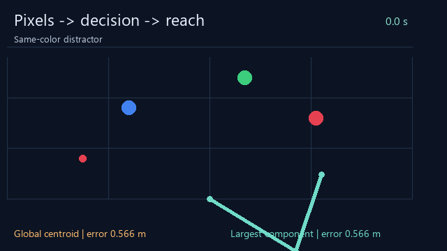

# embodied-reach-lab · Can a robot arm see its target?

[中文](README.md) · [Play the demo](https://flessnerchernosky-ops.github.io/embodied-reach-lab/?lang=en) · [Research roadmap](ROADMAP.md)

Give an arm a color instruction. It locates the target in synthetic RGB camera frames, computes joint actions and reaches toward it. Compare the centroid of all matching pixels with the largest connected component. Perception errors become action errors: a small starting point for embodied interaction.



**No hardware, account or payment required.** Open `docs/index.html` from a downloaded repository or use the hosted demo. Interface and guide support Chinese/English. Experiment data stays in the browser; CSV exports are generated locally.

## Start in three minutes

1. Open the demo and click Finish experiment to compare both methods.
2. Change one variable, such as delay, and rerun. Scene changes reset the experiment; changing language preserves results.
3. Download the CSV and write one evidence-backed finding. Export requires a completed run; metadata records settings, time step and completion.

## One measured example

Default distractor scene, zero delay, red instruction. Initial transients are included:

| 方法 Method | 全程 RMSE / Full-run RMSE (m) | 末段 / Late RMSE (m) |
|---|---:|---:|
| 普通中心法 / Global centroid | 0.480992 | 0.486746 |
| 最大色块法 / Largest component | 0.101467 | 0.003125 |

On the moving target, both detectors perform identically; selecting the largest component does not solve stale observations.

The saved [benchmarks.json](benchmarks.json) contains 10 paired configurations / 20 trajectories. [trace.csv](trace.csv) stores the complete default raw run. Other traces can be exported from the browser or generated with the engine. These are deterministic results, not random trials or statistical confidence estimates. Recomputing identical data does not strengthen empirical evidence. Thresholds, time windows and model assumptions matter.

## Reproduce locally

Node.js 18+ and Python 3.9+, standard libraries only. No Python package or npm dependency installation for the core experiments. Run from the repository root:

```sh
node test.cjs
node benchmark.cjs --check
python verify.py
```

This runs 17 model checks, verifies the saved paired benchmark, and independently audits geometry/metrics with Python. After deliberate model changes, `node benchmark.cjs` regenerates data; explain the changes and preserve failure cases. Optional local server: `python -m http.server 8000 --directory docs`, then open `http://localhost:8000`.

Optional preview regeneration: install Pillow (`python -m pip install Pillow`), then run `python build_preview.py`. Animation samples the default CSV; fonts/Pillow may change image bytes without changing numerical results.

## Implementation and scope

- Camera: 96 × 80 RGBA, known orthographic calibration, 10 Hz. Delay affects whole observations; actuation is immediate. Pixel centers map to world coordinates using `pixel/world`.
- Perception: fixed RGB prototypes for red/blue/green; per-channel difference <35, minimum 4 pixels. Four-neighbor connected components. The detector receives only pixels and the requested color. A larger same-color distractor can defeat the largest-component rule.
- Servo: fixed positive-elbow IK, link lengths 1 m and 0.8 m; independent unit-inertia joints with `q̈ = u − 0.3q̇`, `u=clip(8(q_ref−q)−4q̇,−6,6)`. Missing detection requests braking only. Semi-implicit Euler, dt=0.01 s; speed limit 2 rad/s and joint bounds `[-π,π]`, `[0,π]`.
- Initial angles `[-0.55,1.8]`, zero velocity. Duration 12 s; late metric covers (8,12] s; near-target radius 0.06 m. Both methods use identical frames, delay and servo gains.
- World truth is used to synthesize images, draw and score, never supplied to the detector. In the missing-image scene the red object is absent from the camera frame; error is still measured against its hidden reference position and is not evidence of successful detection.
- No learned VLA, free-text interpretation, real camera, physical grasp/contact, collision, gravity or coupled link dynamics. This is an educational reaching simulation.

RMSE is the square root of mean squared Euclidean position error over equally spaced time samples. Late RMSE uses the window above. Near-goal seconds accumulate time within a distance threshold; they do not establish grasping or task completion. Detection availability is the fraction of control steps with a nonempty most recently delivered detection.

| File | Purpose / 用途 |
|---|---|
| `docs/index.html`, `app.js`, `style.css` | Bilingual browser UI / 双语交互 |
| `docs/engine.js` | Shared browser/Node model / 同一计算模型 |
| `test.cjs` | 17 meaningful model checks / 17 项模型检查 |
| `benchmark.cjs`, `benchmarks.json` | Reproducible paired study / 可复现对照 |
| `trace.csv`, `verify.py` | Raw default run + independent audit / 默认原始数据与独立审计 |
| `build_preview.py` | Optional GIF/cover regeneration / 可选重建动图及封面 |
| `ROADMAP.md` | Research extensions / 研究拓展 |


## Develop this into an application portfolio

Reproduce the result and explain one success and one failure yourself. Complete a controlled study from [ROADMAP.md](ROADMAP.md), then report your changes, tuning budget, held-out evaluation scenes and findings. Initial code and documentation were AI-assisted. Describe your actual modifications and independent validation in application materials.

## References, contributions and license

[LeRobot](https://github.com/huggingface/lerobot) supplies datasets, models and tools for real robot learning, and offers a future observation → policy → action interface reference. This project implements transparent color rules and joint servos; it does not integrate or reproduce LeRobot or a VLA. Arm geometry and teaching assumptions continue the author's [robot-delay-lab](https://github.com/flessnerchernosky-ops/robot-delay-lab); the perception loop is implemented separately.

See [CONTRIBUTING.md](CONTRIBUTING.md) for useful starter contributions. If the experiments help you, a Star or a shared finding is welcome. MIT License: [LICENSE](LICENSE).
